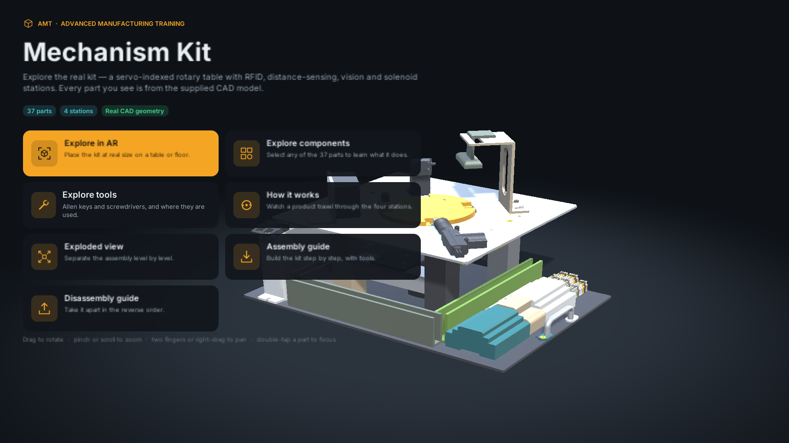
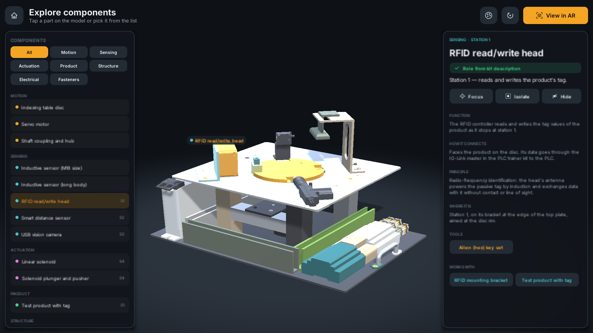
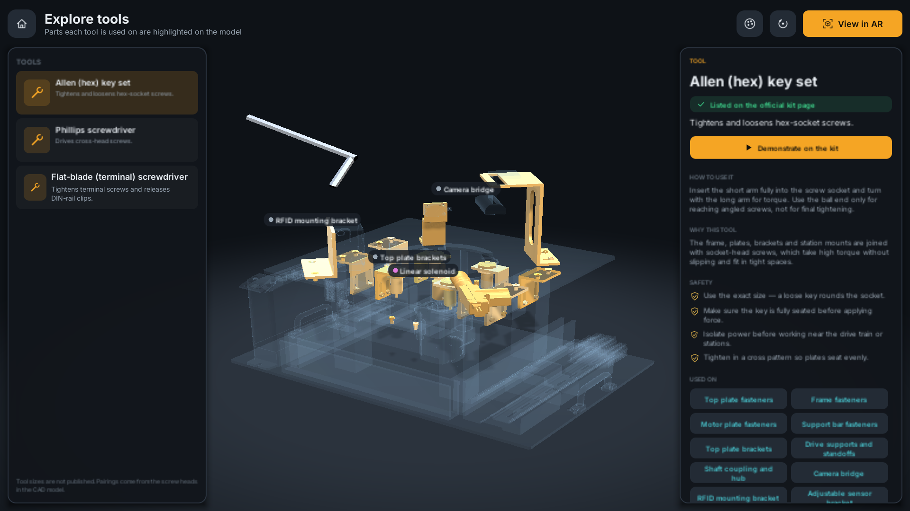
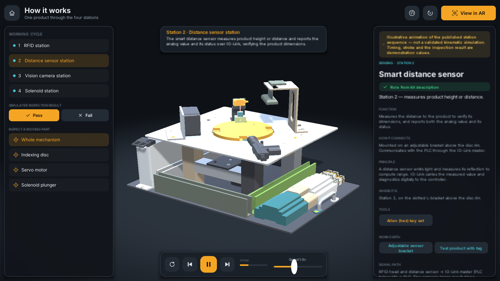
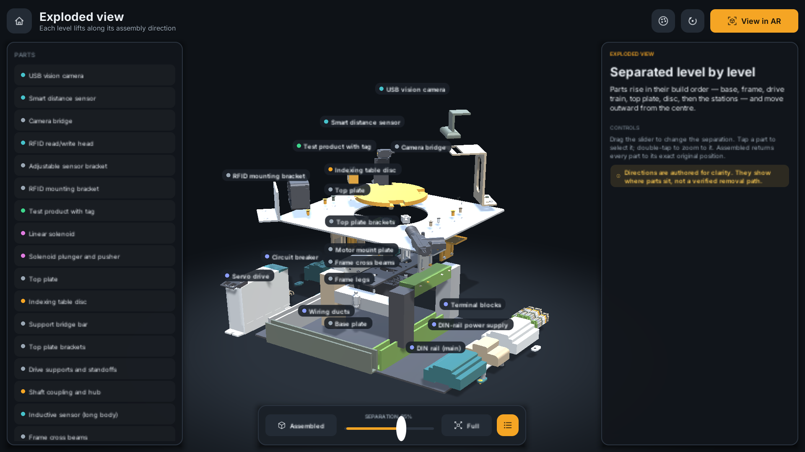
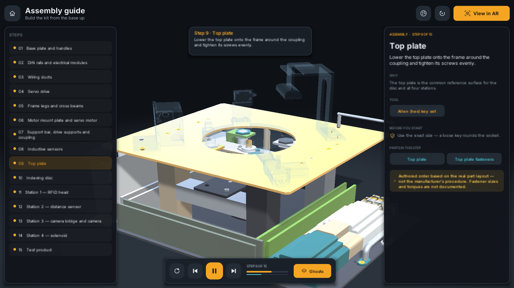
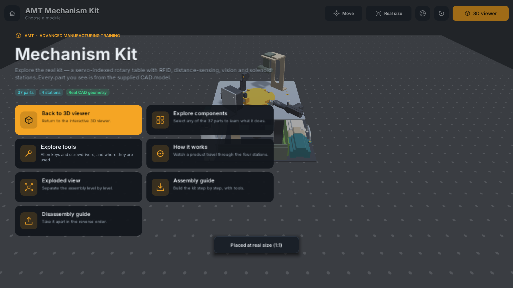
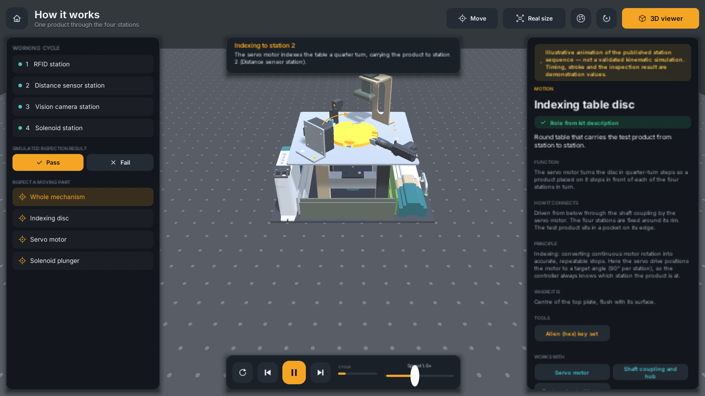

# AMT Mechanism Kit — AR Training App (Unity, Android)

An interactive training app for the AMT Mechanism Kit, a servo-indexed rotary table with RFID,
distance-sensor, vision-camera and solenoid stations. You can explore every part of the **real CAD
model**, learn the tools, watch the working cycle, explode the assembly, follow guided assembly and
disassembly with tool animations, and place the kit **at real size** on a table with AR.

## Download the app (Android)

**[Download the latest APK from Releases](https://github.com/adityawadhwa05/AMT-Mechanism-Kit-Unity/releases/latest)**

1. On your Android phone, open the link above and download `AMT-Mechanism-Kit-v….apk`.
2. Open the downloaded file. If Android asks, allow your browser or file manager to **install unknown
   apps**.
3. Open **AMT Mechanism Kit**.

- **Needs:** Android 7.0 or newer on a 64-bit (ARM64) phone.
- **AR mode** also needs an [ARCore-supported phone](https://developers.google.com/ar/devices) with
  Google Play Services for AR (the app offers to install it). On other phones, everything else works
  in the 3D viewer.
- **AR tip:** point at a table or the floor and move the phone slowly *sideways* until the dot grid appears.

> **Status:**
> - Compiles in Unity 6000.0.60f1 and passes validation.
> - Automated Play-mode smoke tests pass in both scenes.
> - The Android APK builds (`Build/AMTMechanismKit.apk`).
> - Tested on a Samsung Galaxy S23+ (Android 16): the 3D viewer and AR placement both work. See [Testing status](#testing-status).

| Home | Components | Tools |
| --- | --- | --- |
|  |  |  |
| **How it works** | **Exploded view** | **Assembly guide** |
|  |  |  |
| **AR (Editor simulation): placed** | **AR: how it works** | |
|  |  | |

_Screenshots captured automatically by `AMT Kit → Run Smoke Test` in the Unity Editor._


## What's in the app

| Module | What it does |
| --- | --- |
| **Explore in AR** | ARCore surface detection, placement reticle with the kit's real footprint (53 × 37 cm), anchored placement at **1:1 scale**, drag to move, twist to rotate, pinch to scale (snaps back to real size), soft shadow on the real surface, light estimation, tracking-loss messages, camera-permission and unsupported-device states. |
| **Explore components** | All 37 parts are individually selectable, from a category-filtered list or by tapping the model. Details cover function, connections, principle, location, tools and related parts. Focus, isolate (X-ray context) and hide. |
| **Explore tools** | Allen keys, Phillips and flat-blade screwdrivers as 3D models, with purpose, correct use, reason and safety. The parts each tool is used on are highlighted, and *Demonstrate* runs the tool on the real screw positions. |
| **How it works** | The test product travels RFID → distance → vision → solenoid. Index angles are computed from the real station positions. Station effects (RFID field, distance beam, camera view), a motion arrow, captions, play/pause/step/restart, 0.25–2× speed, a simulated pass/fail result (a fail fires the solenoid plunger), and focus on one moving part. |
| **Exploded view** | Level-by-level separation (0–100 % slider, presets), part labels, selection, isolation, and an exact return to the assembled pose. |
| **Assembly / Disassembly guide** | 15 steps. Parts fly in or out along their approach direction, then the correct tool turns on the actual screws. Previous / next / replay / restart / pause, progress, "ghost" view of remaining parts, step details. |

Every module works in both the 3D viewer and AR.

## The model: from one mesh to 37 real parts

The supplied `MechanismKit.glb` is one Draco mesh with eight colour groups and no part names.
Analysis showed it still contains **276 separate CAD bodies**. `Tools/ModelPipeline` finds them,
groups them into 37 named parts (screws grouped as `<part>__fasteners`), and writes
`Assets/StreamingAssets/Model/MechanismKit_Parts.glb`:
- One node per part, with its pivot at the part's centre.
- Draco-compressed, 0.7 MB.
- Exactly the same 197,004 triangles, with original normals and colours.
- The source's −Z-up millimetre frame converted to Unity's Y-up metres. The original model was lying
  on its back in the previous app.

The supplied files are unchanged: `MechanismKit.glb` and everything in
`Assets/Models/Source` and `AMTMechanismKit/`.

**How names were verified.** Each part's text in `Assets/Resources/Data/components.json` carries a `verification` field:
- `published`: the role is stated in the kit description at
  [iafsm.in](https://www.iafsm.in/index.php?id=14&option=com_sppagebuilder&view=page). This covers the
  servo motor and drive, indexing table, RFID head, distance sensor, USB camera, solenoid and test
  product.
- `geometry`: recognised from shape and position only, for example DIN rails, the power supply,
  terminal blocks, the circuit breaker and frame parts. The app labels these
  "Identified from CAD shape — confirm on kit".

The station assignment follows the published order and the geometry: the camera hangs from the
bridge over the disc, and the bellows solenoid pushes at the disc rim. The tool list matches the
official AR page (screws, Allen keys, screwdrivers). Tool sizes, torques and the manufacturer's
assembly procedure are **not published**, and the app says so wherever it matters.

## Requirements

- **Unity 6000.0.60f1** (Unity 6), with **Android Build Support** (OpenJDK + Android SDK & NDK).
- Packages (resolved automatically from `Packages/manifest.json`):

| Package | Version |
| --- | --- |
| AR Foundation | 6.0.8 |
| Google ARCore XR Plugin | 6.0.8 |
| XR Plugin Management | 4.5.0 |
| XR Core Utilities | 2.4.0 |
| Input System | 1.11.2 |
| Unity UI (uGUI) | 2.0.0 |
| glTFast | 6.14.0 |
| Draco | 5.3.0 |

- An **ARCore-supported Android phone** (Android 7.0 / API 24+, ARM64) for AR. The 3D viewer runs on any device.

## Install Unity and open the project

1. Install **Unity Hub** from https://unity.com/download and sign in. Choose the free **Personal** license.
2. Install the Editor **6000.0.60f1**, either from Hub **Installs → Install Editor → Archive**, or by
   opening `unityhub://6000.0.60f1/61dfb374e36f` in your browser. Tick **Android Build Support**
   with **OpenJDK** and **Android SDK & NDK Tools**.
3. In Hub use **Projects → Add → Add project from disk**, and pick this folder (the one containing
   `Assets/`, `Packages/`, `ProjectSettings/`). The first import takes a few minutes.
4. Open `Assets/Scenes/Viewer.unity` and press **Play**. In the Game view use a landscape
   resolution such as 1920×1080. The AR scene (`Assets/Scenes/AR.unity`) also runs in the Editor,
   with a simulated floor: click to place, left-drag to move, right-drag to rotate, scroll to scale.
5. Run **AMT Kit → Validate Project**. It checks files, shaders, data integrity and GLB node names
   against `components.json`, plus the ARCore setup.

## Build and install on Android

1. **File → Build Profiles → Android → Switch Platform.**
2. **AMT Kit → Configure Android ARCore.** This sets ARM64, IL2CPP, API 24+, OpenGLES3 and the ARCore loader.
3. **AMT Kit → Build Android APK.** The output is `Build/AMTMechanismKit.apk`. Alternatively, set
   `UNITY_EDITOR` to your `Unity.exe` path and run `BUILD_ANDROID.bat`.
   Batch builds can point at a specific SDK/NDK/JDK through the `AMT_ANDROID_SDK`,
   `AMT_ANDROID_NDK` and `AMT_JDK` environment variables. Use NDK r27c and JDK 17; the target API is
   pinned to 36.
4. On the phone enable **Developer options → USB debugging**, connect it, and run
   `adb install -r Build/AMTMechanismKit.apk`. Unity's **Build And Run** also works.
5. The APK is signed with Unity's debug key. Create a release keystore under **Player Settings →
   Publishing Settings** before distributing.

## Editing the project

Scenes are thin entry points. `Viewer.unity` holds `ViewerBootstrap` and `AR.unity` holds
`ARBootstrap`, and everything else is built at runtime from code and data, so changes rarely need
scene editing.

| To change… | Edit |
| --- | --- |
| Part names, descriptions, categories, explode offsets | `Assets/Resources/Data/components.json` |
| Station explanations used in captions | `stations` in `components.json` |
| Tools, safety notes, which parts use them | `Assets/Resources/Data/tools.json` |
| Assembly / disassembly steps | `Assets/Resources/Data/guide.json`. Each part must appear in exactly one step; set `"verified": true` only after review by a qualified owner. |
| Colours, fonts, UI tokens | `Assets/Scripts/Core/Theme.cs`, `Assets/Scripts/Core/KitMaterials.cs` |
| Which bodies form a part | `Tools/ModelPipeline/part_map.json`, then rerun the pipeline (see its README) |

**Replacing the model.** Export a GLB whose part nodes are named with the ids in `components.json`,
put it at `Assets/StreamingAssets/Model/MechanismKit_Parts.glb`, and run **Validate Project**. A
manufacturer CAD export with named parts can replace the recovered segmentation directly.

### Code map

```
Assets/Scripts/
  Core/          KitModel (load GLB, part registry, highlight/ghost/hide), KitPart, KitMaterials,
                 TrainingSession (shared state), Theme, MeshBuilder, PointerInput, AppNavigation,
                 ViewerBootstrap (Viewer scene entry)
  Data/          KitDatabase — JSON data classes and loader
  Interaction/   GestureInput (tap, double-tap, drag, pinch, twist, pan), OrbitCamera
  Animation/     ExplodedView, MechanismCycle (working cycle), Overlays (arrows, station effects)
  AssemblyGuide/ GuidePlayer
  Tools/         ToolModels (procedural tools + ToolRig), ToolShowcase
  UI/            TrainingShell (frame, home, overlays), UIFactory, Icons, WorldLabels,
                 ModuleScreen + Screens/ (Components, Tools, HowItWorks, Exploded, Guide)
  AR/            ARBootstrap (AR scene entry and flow), ARVisuals
Assets/Resources/  Data/*.json, Shaders/*.shader, Fonts/Inter-*.ttf (SIL OFL)
Assets/Editor/     ProjectSetup, ProjectValidation, AMTBuildRecovery
Tools/ModelPipeline/  part segmentation pipeline (Node + Python)
```

## AR configuration

AR uses **horizontal plane detection**, so no printed image target is needed. The original Vuforia
model target (`AMTMechanismKit.dat/.xml`) is kept as source only; Vuforia is not part of this
project. To add image tracking later:
1. Add an `ARTrackedImageManager` to the XR Origin in `ARBootstrap.BuildCamera()`.
2. Create a Reference Image Library with the printed image and its **physical width in metres**.
3. Place the kit at the tracked image's pose instead of a plane hit.

## Testing status

**Verified (28 October 2026, Unity 6000.0.60f1):**
- **Compilation.** The project compiles with no errors or warnings from project code, and all
  custom shaders compile.
- **Validation.** `AMT Kit → Validate Project` passes.
- **Automated Play-mode smoke test** (`AMT Kit → Run Smoke Test`, or batch
  `-executeMethod AMTSmokeTest.RunBatch -amtScene Viewer|AR`):
  - Viewer: the kit loads with 37 parts at its real size (0.532 × 0.392 × 0.370 m), and every module
    opens and animates with no errors or exceptions.
  - AR (Editor simulation): loads, places and runs modules.
  - Each run writes screenshots and a report to `Build/Screenshots/`.
- **Android build.** The IL2CPP APK builds (ARM64, API 24–36, debug-signed). ARCore and depth are
  set to optional, so non-AR phones can still use the 3D viewer.
- **Model pipeline.** It reproduces the shipped segmentation, and all 197,004 triangles are preserved.

**On a phone (Samsung Galaxy S23+, Android 16):**
- The 3D viewer modules work in landscape at 2340×1080.
- AR works: surface detection, real-size anchored placement, re-placement, the top-bar actions, and
  switching between AR and the viewer, with no errors in logcat.

**Not yet measured:** frame rate and load time on mid-range phones, and behaviour in poor light.

See `Build/BUILD_REPORT.md` for build details, including the Android SDK/NDK/JDK setup used.

## Licences

Inter font © The Inter Project Authors, SIL Open Font License 1.1 (`Assets/Resources/Fonts/OFL.txt`).
The kit model and documents belong to their owners and are included as supplied.
